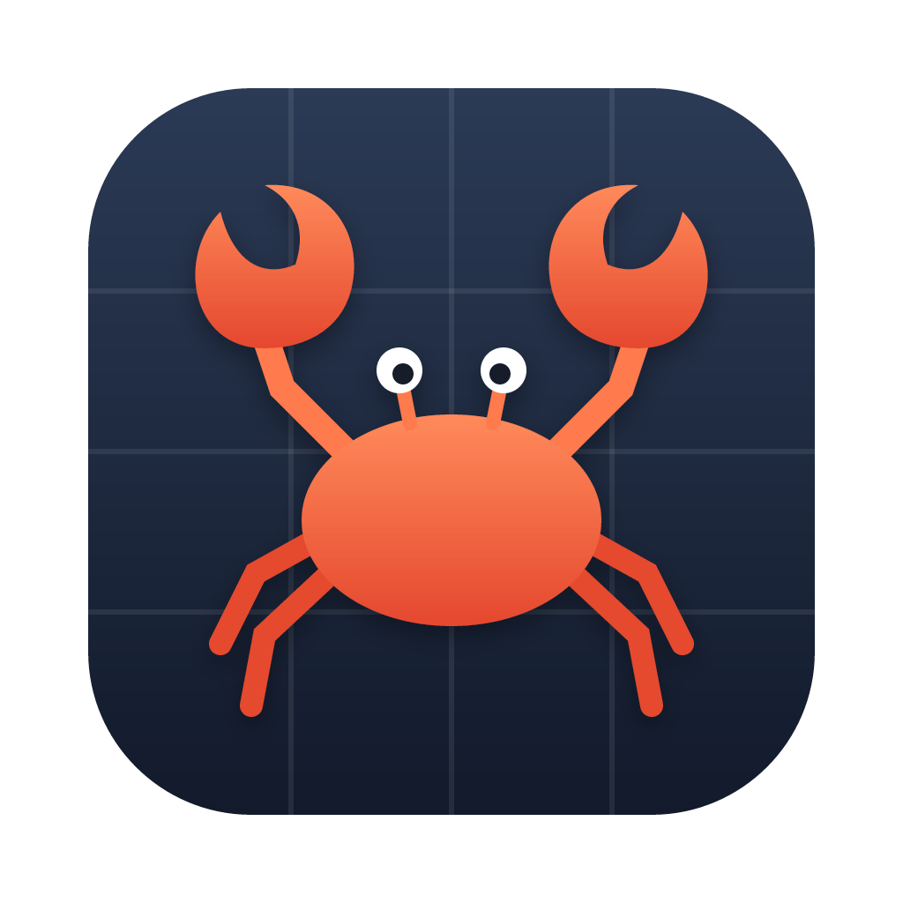

<p align="center">
  
</p>

<h1 align="center">crabtrap</h1>

<p align="center">
  An HTTP/HTTPS debugging proxy for macOS, in the spirit of Charles and Proxyman.<br>
  Written entirely in Rust, with a native GPU-rendered UI (GPUI).
</p>

---

## Features

- **HTTPS interception (MITM)** with a local root CA, per-host SSL Proxying, and one-step setup for phones and other devices on your network (QR code, iOS configuration profile).
- **Traffic** — live table with filters (`host:`, `status:4xx`, `method:`, `type:`, `re:`), full-text search in headers and bodies, sidebar grouped by domain and app.
- **Inspectors** — headers, query, cookies, JSON/text/hex/image bodies, timing, WebSocket messages.
- **HTTP/2 and WebSockets.**
- **Tools** — Allow List, DNS Spoofing, Reverse Proxy, Block List, Map Local (files or folders, custom status and headers, one-click
  "Save Response & Map Local"), Map Remote, Throttle, Rewrite, Breakpoints, and JavaScript **Scripting**.
- **Repeat, Edit & Resend, Compose**, **Copy as cURL / fetch / fetch (Node.js)**, **HAR export** (one request or the whole session).
- macOS system proxy toggle, menu bar icon, status bar warnings, Check for Updates.

## Install

Requires macOS 13 Ventura or later (Apple Silicon or Intel).

### Homebrew

```sh
brew install --cask underherzen/tap/crabtrap
```

### Manual

Download `crabtrap-<version>-macos-universal.dmg` from
[Releases](../../releases/latest), open it, and drag **crabtrap** to Applications.

> [!IMPORTANT]
> Releases are not notarized by Apple yet. macOS blocks the first launch:
> open **System Settings → Privacy & Security** and click **Open Anyway**, or run
>
> ```sh
> xattr -dr com.apple.quarantine /Applications/crabtrap.app
> ```
>
> The Homebrew cask does this for you.

## Getting started

1. Launch crabtrap and press **Start Proxy**. By default it listens on port `8080` on all
   interfaces, so devices on your network can use it too (switch to local-only in **Settings → Network**).
2. Turn on **macOS Proxy** in the toolbar to route system traffic through crabtrap.
3. To see HTTPS contents, open **Settings → Certificates**, install and trust the crabtrap root CA,
   then enable SSL Proxying for the hosts you care about (**Tools → SSL Proxying**, or right-click a request).
4. For phones and tablets: point the Wi-Fi proxy at your Mac's address and port `8080`, then scan
   the QR code in **Settings → Certificates** to install the certificate.

> [!NOTE]
> Browsers may use HTTP/3 (QUIC over UDP) and bypass any HTTP proxy. Disable QUIC in the browser
> while debugging if requests are missing.

Your data lives in `~/Library/Application Support/crabtrap` (config, rules, root CA, saved mocks).

**How to use each tool** — matching syntax, Map Local, Rewrite, Breakpoints, Scripting and more —
is in the [User Guide](docs/guide.md) (also **Help → User Guide** in the app).

## Build from source

```sh
# Rust toolchain is pinned in rust-toolchain.toml
cargo run -p app --bin crabtrap              # debug build
scripts/bundle-macos.sh                      # dist/crabtrap.app + .dmg (Apple Silicon)
scripts/bundle-macos.sh --universal          # arm64 + x86_64
```

Checks run in CI:

```sh
cargo fmt --all -- --check
cargo clippy --workspace --all-targets -- -D warnings
cargo test --workspace
cargo deny check
```

The architecture (clean/hexagonal layers plus the proxy `engine`) is described in
[ARCHITECTURE.md](ARCHITECTURE.md).

## Releasing

1. Add notes under `## [Unreleased]` in [CHANGELOG.md](CHANGELOG.md).
2. `scripts/release.sh X.Y.Z --push` bumps the version, moves the changelog section, commits,
   tags `vX.Y.Z`, and pushes.
3. The **Release** workflow builds a universal `.dmg` and creates a **draft** GitHub release.
4. Review and publish the draft. Publishing triggers the **Homebrew** workflow, which updates the
   cask in `underherzen/homebrew-tap`.

Signing: without secrets the app is ad-hoc signed. To ship notarized builds, add the repository
secrets `MACOS_CERT_P12` (base64 Developer ID Application certificate), `MACOS_CERT_PASSWORD`,
`MACOS_SIGN_IDENTITY`, and an App Store Connect API key: `APPLE_API_KEY_P8`, `APPLE_API_KEY_ID`,
`APPLE_API_ISSUER`. The Homebrew workflow needs `TAP_TOKEN` (fine-grained PAT with write access to
the tap repository).

## License

Licensed under either of

- Apache License, Version 2.0 ([LICENSE-APACHE](LICENSE-APACHE))
- MIT license ([LICENSE-MIT](LICENSE-MIT))

at your option.
